# Fine-tuning and held-out validation report | Real-estate asking-price model

**Business audience:** U.S. residential acquisition screening managers and brokerage valuation teams.

**Business objective:** Generate a defensible, reproducible *asking-price prediction baseline* for prioritizing human-reviewed listings. This is **not** a market-value appraisal, sold-price predictor, investment-return model, or proof that a home is undervalued.

**Champion:** Custom gradient-boosted shallow regression trees implemented in **R / rpart**, selected from four candidates using development-validation MAE. After nine tuning trials, the final configuration was **locked BEFORE test access**.

## 1. Executive conclusion: operational promise with strong restrictions

| Metric on full independent held-out test | Result |
|---|---:|
| Test records (never used for selection/tuning) | **137,689** |
| Mean absolute error, MAE | **$257,631** |
| Root mean squared error, RMSE | $710,981 |
| Median absolute error | $105,140 |
| Log-price RMSE | 0.5481 |
| Dollar-scale R² | 0.480 |
| Mean absolute percentage error, MAPE | **46.08%** |
| Illustrative naive row-bootstrap 95% MAE interval | $254,074 to $260,689 |

**Decision:** This model **is not reliable enough for unsupervised price setting or acquisition offers.** Even though it beats simpler candidates on sampled validation MAE, the high overall dollar and percentage error and systematic biases for inexpensive/luxury listings demand stronger geographic features, newer data, human market-comparable review and revalidation before any deployment.

The bootstrap interval treats rows as independent and thus **does not account for multiple listings sharing a property surrogate**. It is descriptive, potentially overconfident, and does not measure future-market distribution shift.

## 2. Dataset, selection context and leakage barriers

Input: original Kaggle [USA Real Estate Dataset](https://www.kaggle.com/datasets/ahmedshahriarsakib/usa-real-estate-dataset), version 25. EDA restricted to **for_sale**, plausible asking price $30,000–$20 million, living area 400–20,000 sqft and known state, yielding **916,718** model-ready rows. EDA created deterministic, group-disjoint partitions: **641,573 train**, **137,456 validation**, **137,689 test**.

For selection and tuning, we sampled **40,000 training** and the same **12,000 validation** rows, fixed seed **20261022**. Testing only the winner on a fresh 137,689-row test partition protects the final assessment from repeated model-selection peeking.

The final model was refitted on **80,000 allowed development rows** (64,000 sampled from train, 16,000 from validation) with locked hyperparameters; this is **not** a model trained on the full ~779k development records. A different training size would warrant additional independent assessment before production.

Model response = **natural log of listing asking price**. Predictors are log living area, bedrooms/bathrooms, log1p lot size, missingness indicators, and state-group categorical information (20 highest-frequency states measured from development data plus Other).

**Excluded due to leakage / questionable timing:** target-derived price-per-sqft, actual listing price as a predictor, target-mean location encodings fitted outside training, original rows/group ID as features, and `prev_sold_date` as an observation date. The data lacks validated as-of listing timestamps; results are not a current listing-price index.

**No external joins:** city/ZIP socioeconomic data and contemporaneous market factors could improve prediction but require verified keys, timestamps and source licenses. None was fabricated or silently merged.

## 3. Sequential tuning approach and evidence

The stage prior to tuning selected gradient-boosted CART over OLS, single CART and randomized bagged CART with **$268,754 validation MAE**. We then **appended, ran and inspected three successive tuning passes**:

1. **T1**: baseline, more small-learning-rate rounds, and depth-3 alternative; depth 3 improved to **$262,112 MAE**.
2. **T2**: depth 3 with changed rates/rounds versus depth 4; depth 4 reached **$258,434 MAE**.
3. **T3**: local depth-4 refinements plus depth-5 counterfactual; depth 5 reached **$257,254 MAE**, then settings were locked in a local manifest.

### All nine actual validation experiments

| Setting | Trees | Depth | Learning rate | Validation MAE |
|---|---:|---:|---:|---:|
| **depth5_check (chosen)** | **105** | **5** | **0.08** | **$257,254** |
| depth4_higher_rate | 120 | 4 | 0.11 | $257,561 |
| depth4_more_rounds | 145 | 4 | 0.07 | $257,769 |
| depth4_lower_rate | 105 | 4 | 0.08 | $258,434 |
| depth3_faster_rate | 115 | 3 | 0.12 | $260,006 |
| depth3_more_rounds | 115 | 3 | 0.08 | $261,157 |
| deeper_trees | 85 | 3 | 0.10 | $262,112 |
| **selection_default** | 75 | 2 | 0.10 | $268,754 |
| more_trees_small_steps | 110 | 2 | 0.07 | $269,106 |

All candidates used **72% row subsampling per round**, minimum leaf size **80**, same training/validation subset, and the same absolute dollar-error metric. The best configuration reduced validation MAE by **$11,500 (4.28%)** relative to the originally selected, untuned boosted model. Nine trials are a bounded exploratory search, **not** evidence of a globally optimal hyperparameter combination.

## 4. Business diagnostics: where errors matter

The **held-out full test** revealed substantial heterogeneity:

| Actual asking-price range | Test homes | Test MAE | Mean signed error (predicted − actual) |
|---|---:|---:|---:|
| Below $150k | 16,304 | $111,243 | **+$108,712** |
| $150k–$300k | 34,755 | **$83,731** | +$54,897 |
| $300k–$500k | 39,301 | $111,995 | +$12,496 |
| $500k–$800k | 25,158 | $197,707 | −$58,164 |
| $800k–$1.5m | 13,622 | $436,420 | −$252,750 |
| Above $1.5m | 8,549 | **$1,804,750** | **−$1,590,283** |

The model **overpredicts lower-priced listings** and **underpredicts higher-priced/luxury listings**. A low asking price compared with the model could be a *systematic false bargain flag* rather than an attractive acquisition opportunity.

By sampled test location (not causal location effects), the model has MAE approximately **$164,979 Texas**, **$325,139 Florida**, **$492,669 California** and **$602,117 New York**. These differences reflect regional house-price distributions, missing local attributes and selection biases, not solely geography.

**Interpretation of final test MAE:** Averaged over this selected cross-sectional inventory, predictions are about **$258k away from observed asking prices** in absolute dollars. This does **not** imply that a property is worth plus/minus exactly $258k or that errors are symmetric for every price band. The model has only a **0.480 R²** on held-out *dollar prices*, not an investment success rate.

## 5. Twelve actual graphs generated by the R code

### Fine-tuning comparison

**Figure 1 — Initial three candidate search.** Depth and tree count matter; more shallow rounds alone did not beat a deeper model.

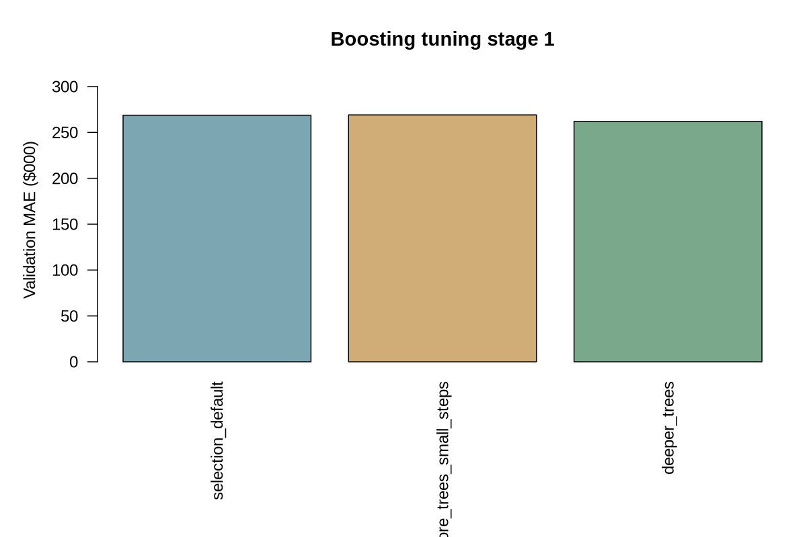

**Figure 2 — First six trial ranking.** Initial adaptive experiments established depth 4 as promising.

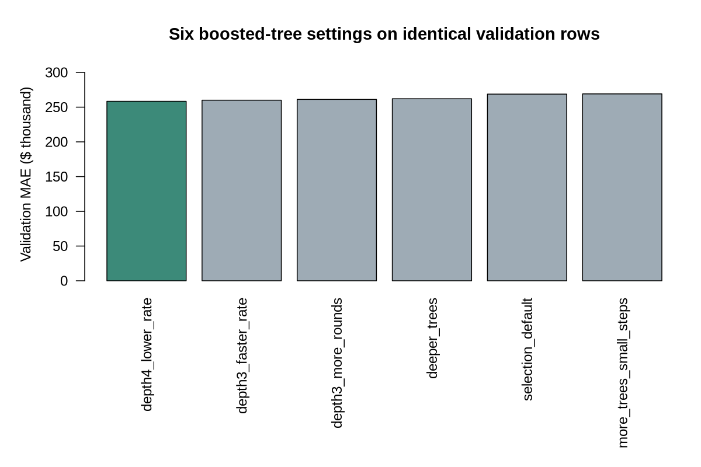

**Figure 3 — Iteration count and validation MAE.** Marks show explored configurations with different depths; this is *not* a controlled monotonic response curve because depth and learning rate also change.

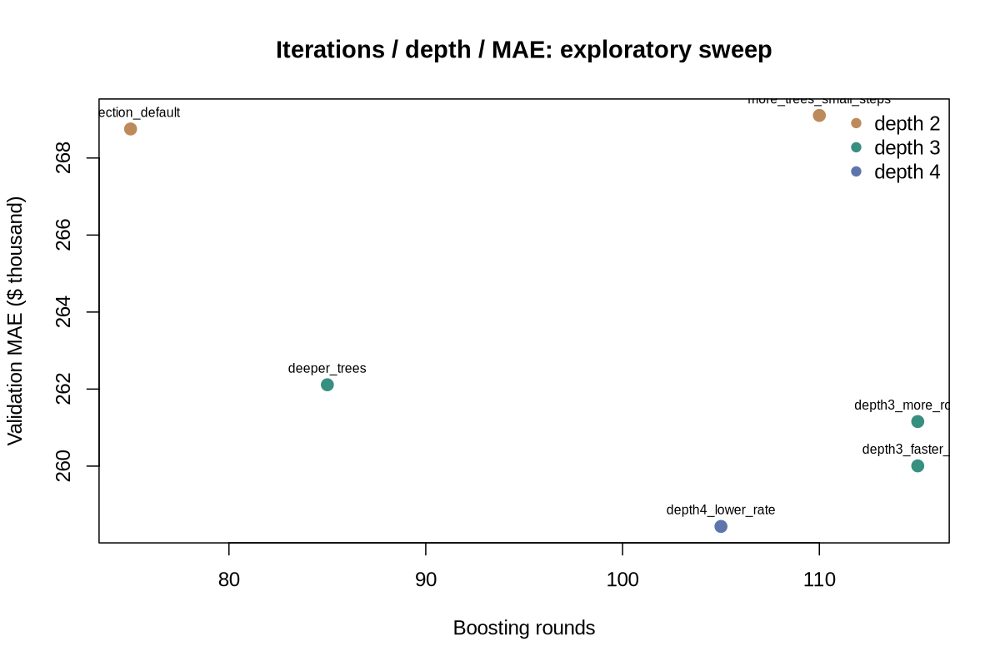

**Figure 4 — All nine trials.** The lowest validation dollar MAE selected the locked depth-5 champion.

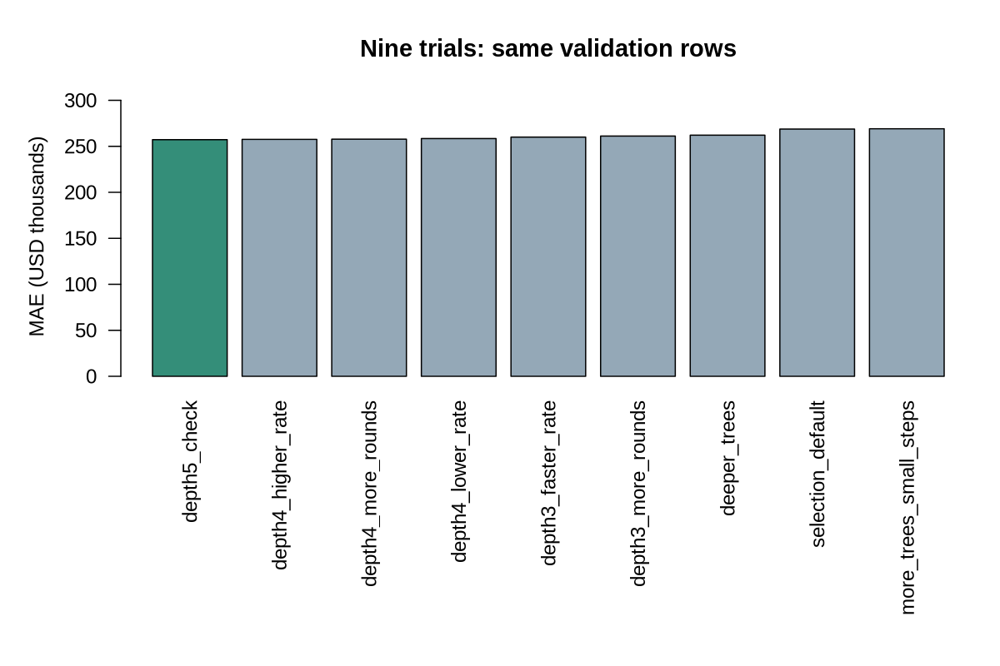

**Figure 5 — Improvement relative to untuned boosted candidate.** Gains are measured on development validation, not on the final test.

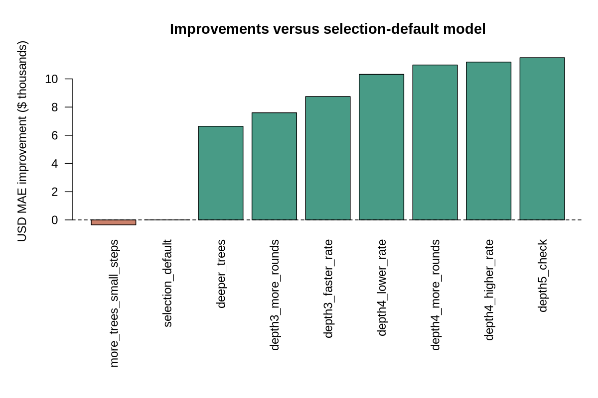

### Final held-out evaluation

**Figure 6 — Actual vs predicted asking prices.** Broad dispersion around a perfect-price line persists.

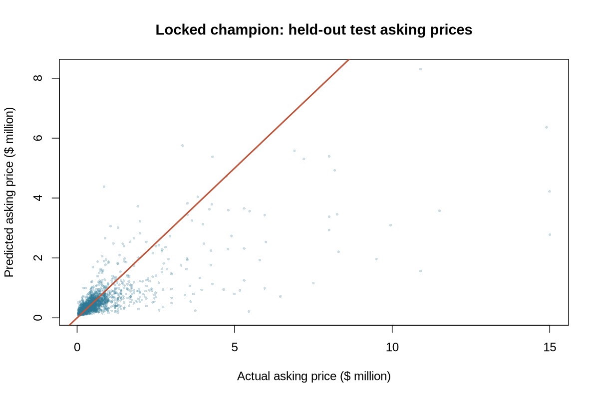

**Figure 7 — Dollar errors by actual price band.** Critical evidence against luxury-home deployment.

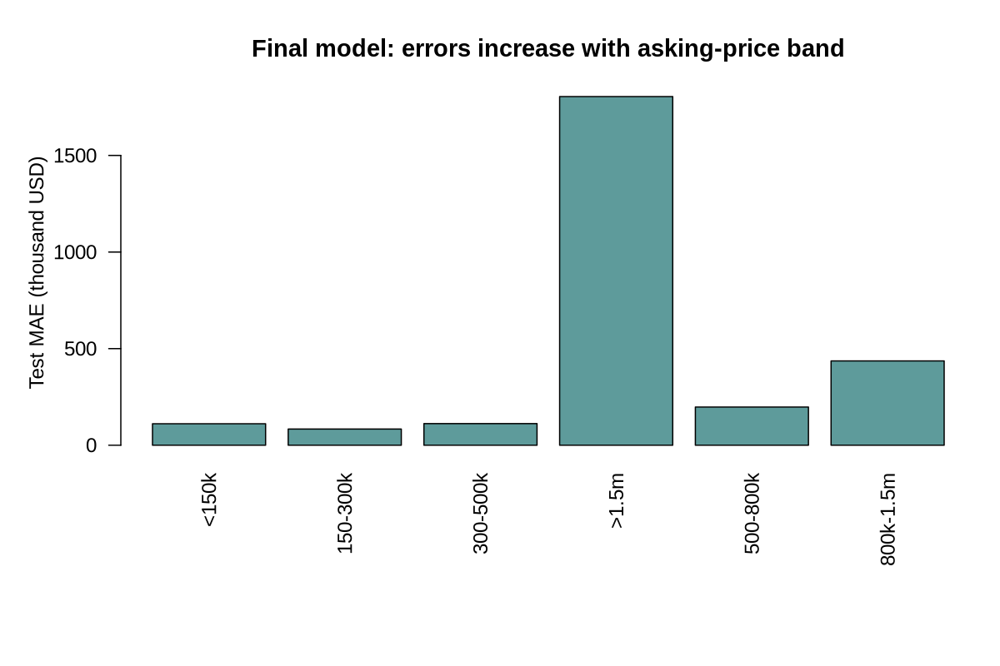

**Figure 8 — State-wise held-out MAE for 15 high-volume states.** Geographic error is heterogeneous; a state without enough records is excluded from this plot.

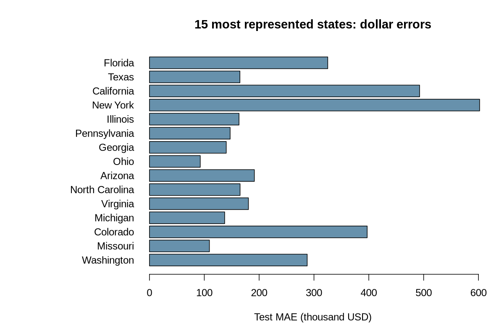

**Figure 9 — Held-out calibration by true asking-price decile.** Dashed line is ideal. The high end falls increasingly below that line, demonstrating systematic underprediction in high-price inventory.

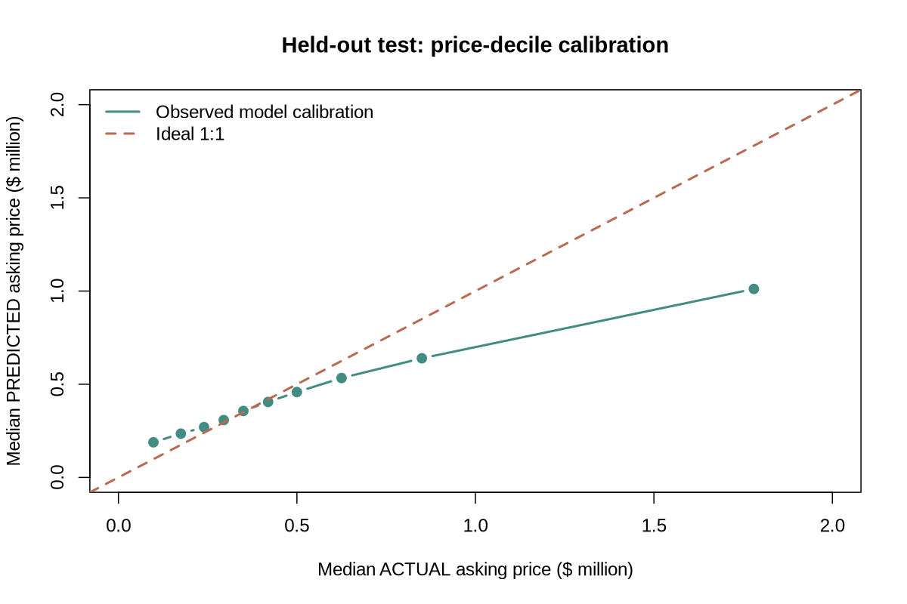

**Figure 10 — Distribution of absolute errors.** Visualized on ln(1 + absolute USD error) to handle skew.

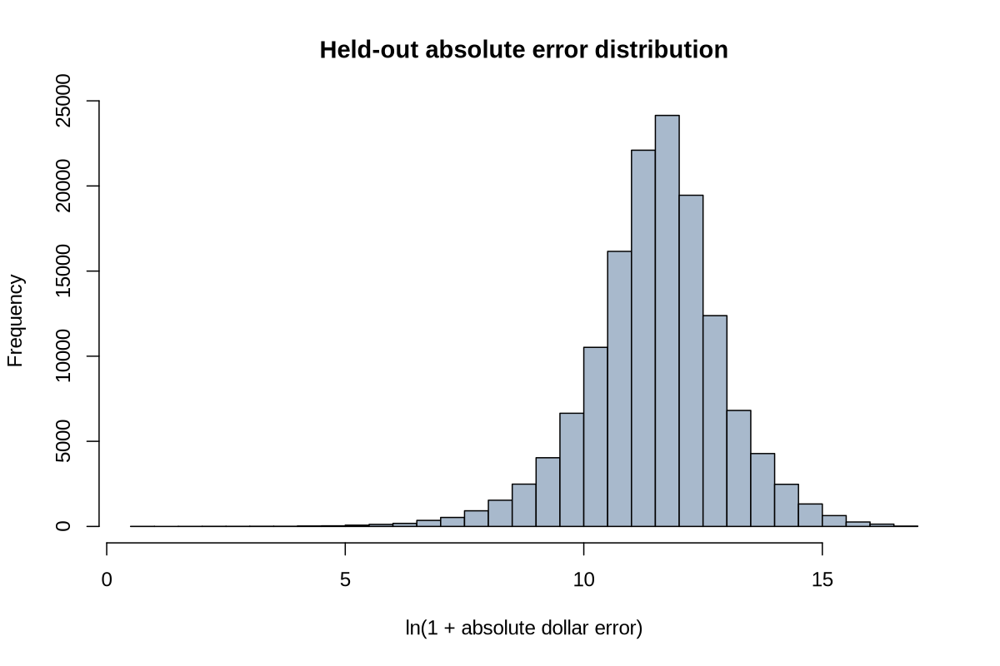

**Figure 11 — Illustrative model response to living area for a fixed Texas-style listing.** Bedrooms=3, bathrooms=2, lot=0.23 acres with other inputs held constant. These are *model estimates*, not observed market sales, renovation returns, or causal effects of extending a home.

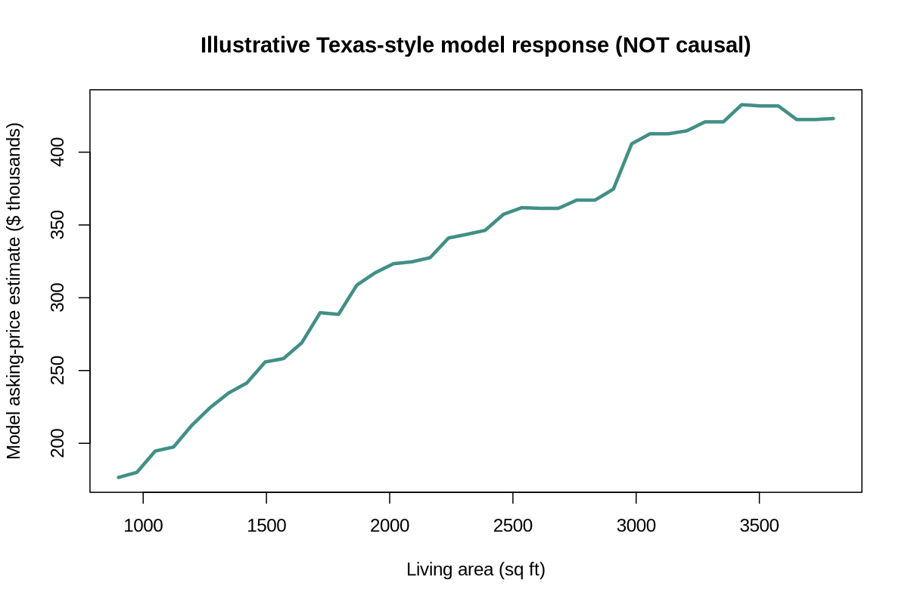

**Figure 12 — Boosted-tree feature usage.** Aggregated split frequency shows variables used by this particular fitted model. **Not causal feature attribution**, not SHAP, not a decomposition of actual property value.

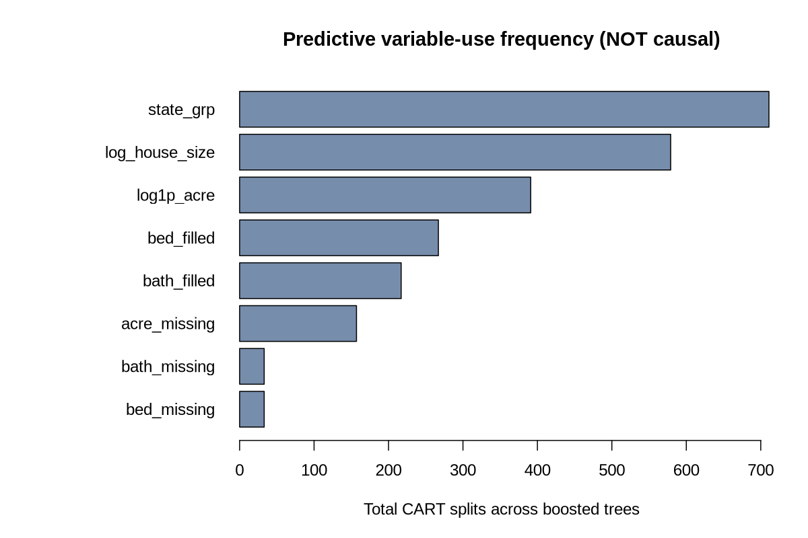

## 6. Business recommendations, predictive statements and controls

**Candidate deployment:** Use predictions only to **triage analyst research**, for example flag listings with large disagreement relative to similar available listings. Require comparable closed sales, maintenance/renovation condition, current listing date, zip/neighborhood characteristics and financial due diligence before any offer or price-setting recommendation.

**Do not automate valuation from these predictions:** A $150k actual property can be overstated by more than $100k on average in the low-price band, and a luxury home can be severely underpredicted. The model's estimates may therefore generate both false-positive "undervalued" opportunities and false-negative expensive market segments.

**Practical next modeling improvements:**

- Obtain legally and temporally consistent *recent closed transaction prices* and verified listing dates; train a sold-price model if transaction valuation is the actual goal.
- Incorporate validated property condition, year built, neighborhood, walkability/schools, quality and ZIP-level economics; use **training-fold-only encoding**, not pooled target medians.
- Evaluate geographic holdouts and chronologically forward holdouts once trustworthy timestamps are available. The current random/group-disjoint cross-sectional split does **not** establish future-market reliability.
- Compare error metrics by price band with risk-adjusted commercial thresholds; publish prediction *intervals* and calibrated uncertainty before any operational decisions.
- Check drift, data licensing and human override design before deployment. The present R model is a reproducible teaching/research baseline.

**Attribution note:** The predictive inputs may be associated with asking price, but neither the boosted split-count plot nor the size-response scenario measures causal effects or guarantees seller behavior. Do not interpret these visuals as recommendations to build more bathrooms or change lot size for a profit.

## 7. Reproducibility, one-time test guard and artifacts

Run from repository root after R, Python and Git prerequisites:

~~~sh
Rscript setup.R
Rscript EDA/eda.R
Rscript modeling/model_selection.R
Rscript modeling/model_fine_tuning.R
~~~

Those commands **do not read the final test during tuning**. After the champion config is locked, run the one-time, explicitly gated evaluation:

~~~sh
Rscript modeling/model_fine_tuning.R --final-test
~~~

The `--final-test` branch checks for an existing local final-test result and **refuses to reevaluate** the partition on subsequent runs. Reproducing exactly on a fresh local checkout is possible; do not use subsequent test outcomes to change hyperparameters. See `modeling/MODEL_PLAN.md` and the [model-selection report](../model_selection/report.md).

Local-only, Git-ignored artifacts under `modeling/artifacts/`: nine trial metrics and predictions, locked configuration, final fitted `.rds`, final test per-row predictions, state/price-band aggregates and bootstrap calculations. Only **R scripts, documentation and small PNGs** are published to GitHub.

**Primary data attribution:** Ahmed Shahriar Sakib, [USA Real Estate Dataset, official Kaggle v25](https://www.kaggle.com/datasets/ahmedshahriarsakib/usa-real-estate-dataset). No raw data redistribution. Results apply to this source and the documented screened/sample population, not necessarily to the present U.S. housing market.
