# Model selection report | U.S. real estate asking-price prediction

**Research question:** Can a U.S. residential-property investment/brokerage team improve its *initial asking-price screening* using property size, rooms, lot size, missingness indicators and broad geography? Which predictive model offers the lowest absolute error on listings not used for training?

**Scope:** Original [USA Real Estate Dataset on Kaggle](https://www.kaggle.com/datasets/ahmedshahriarsakib/usa-real-estate-dataset), version 25. Analysis is in **R**, not Python. Asking prices are not verified transaction prices or appraised values. The dataset does not provide a reliable listing collection period and must **not** be used to infer 2026 appreciation.

## 1. Business objective and decision

A real estate acquisitions or brokerage pricing manager wants a repeatable first-pass property comparison tool. The economic objective is to **reduce time spent manually investigating listings** by identifying unusually priced listings *for further review*, rather than assuming that deviations from predicted asking prices imply arbitrage or profit.

We prioritize **mean absolute error measured in USD (MAE)** because pricing decisions occur in dollars. We also report USD RMSE (penalizes large errors), log-price RMSE, median absolute error and dollar-price R²; lower MAE wins, log-RMSE breaks an exact/near tie. This selection was specified **before** evaluating the four models.

**Recommendation from model-selection stage:** Use a **gradient-boosted CART ensemble** as the candidate for tuning. The result is a preliminary selection on *validation* data, **not** proof that it is accurate enough for autonomous pricing.

## 2. Dataset, reproducibility and leakage control

- Original raw data: **2,226,382** scraped real estate records. EDA retained **916,718** model-eligible `for_sale` listings, with asking price $30k-$20m, stated house size 400-20k sqft, and known state.
- Upstream deterministic property-surrogate-group-disjoint splits: **641,573 train**, **137,456 validation**, **137,689 reserved final test**.
- For fair, bounded candidate comparison: seed **20261022**, fixed **40,000 development-train** rows and the same **12,000 development-validation** rows for all models. No candidate accessed the test partition. This is sampled model selection, not exhaustive fitting on all 641k training rows.
- **Response:** `log_price` (natural log of asking-price USD). We exponentiate and constrain predictions to the modeled $30k-$20m domain for dollar-error measurement.
- **Numeric predictors:** `log_house_size`, `bed_filled`, `bath_filled`, `log1p_acre`. **Indicator predictors:** `bed_missing`, `bath_missing`, `acre_missing`.
- **Location:** the 20 most represented training states plus "Other". This simple train-derived categorization avoids ultra-high-cardinality city/ZIP encodings while retaining broad state effects. It also necessarily misses neighborhood-level variation.
- Missingness replacements (bed 3, bath 2, lot 0.23 acres) were learned **using the upstream train partition only**, *before* these scripts ran. No target-derived geographic averages were joined.
- Property surrogate group IDs are disjoint across original train/validation/test splits, but **street** is an anonymized numeric surrogate rather than a verified legal parcel ID. True property independence cannot be guaranteed.
- Not permitted as X: price, log_price, price/sqft, predictions, source_row, group_id, split, historical previous-sale date, or any aggregate derived from the validation/test targets.

### Four genuinely distinct regression strategies

| Family | Implementation in R | Purpose and expected trade-off |
|---|---|---|
| 1. Log-linear OLS | `stats::lm` with state fixed effects | Transparent baseline, limited nonlinearities |
| 2. Single CART | `rpart::rpart` | Interpretable segmented splits, higher variance |
| 3. Randomized bagged CART ensemble | Bootstrap-trained `rpart` trees, random predictor subset **per tree** | Bagging and diversity reduce instability. **Not** identical to canonical random forest, which samples candidates at each node |
| 4. Gradient-boosted CART | Squared-error gradient updates with shallow `rpart` residual trees | Learns additive nonlinear corrections and interactions, potentially overfits without tuning |

The toolchain deliberately uses R's recommended `rpart` package. Proprietary binary packages or Python estimators are not required.

## 3. Results: same validation records for every model

| Model | Validation MAE | USD RMSE | Median AE | Log RMSE | Dollar R² |
|---|---:|---:|---:|---:|---:|
| **Gradient-boosted CART** | **$268,754** | $784,226 | $110,471 | **0.568** | 0.373 |
| Log-linear OLS | $275,536 | $800,239 | $113,351 | 0.576 | 0.347 |
| Randomized bagged CART | $275,591 | $815,434 | $111,563 | 0.581 | 0.322 |
| Single CART | $280,569 | $781,806 | $115,920 | 0.587 | 0.377 |

**Sanity benchmark:** a training-median constant log-price prediction has validation MAE **$373,569**. The winning boosted model reduces that by about **$104,814 (28.1%)** in this sampled comparison.

**Why this winner?** Boosting ranks first on the predefined USD MAE and the secondary log-RMSE. CART has a slightly lower *USD RMSE* than boosting, but choosing CART based on a different metric after seeing outcomes would violate the predeclared selection rule.

**Original untuned boosting settings:** 75 additive trees, depth 2, learning rate 0.10, 72% rows per boosting round, minimum leaf size 80. Fine-tuning and **one final test** are documented separately in [fine-tuning report](../model_fine_tuning/report.md).

## 4. Visual EDA for selection (all 12 graphs)

### Common data distribution

**Figure 1 — Comparable sampling distribution.** Training and validation log asking-price histograms. Similar-looking shapes do not prove equal housing mix across markets.

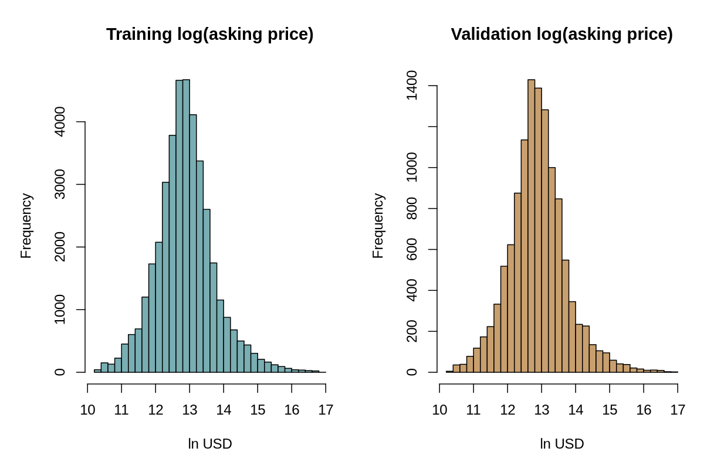

**Figure 2 — Log-linear baseline predictions.** Scatter is against the *observed asking prices* of the validation records; the 45-degree line indicates perfect prediction.

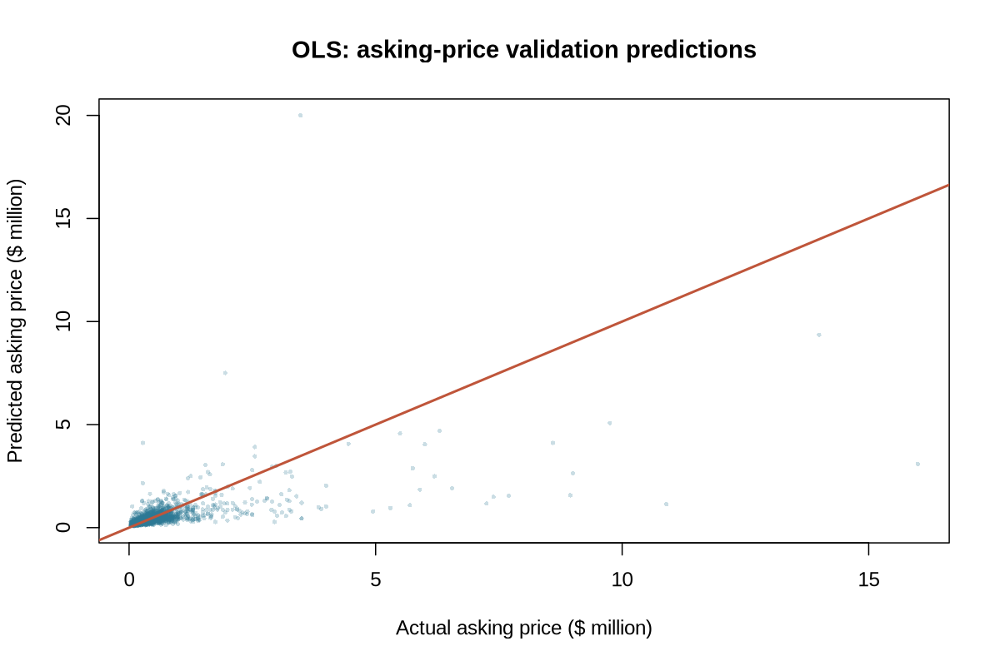

### CART tree

**Figure 3 — Single-tree predicted vs actual.** A shallow tree approximates continuous prices in segments; it is less smooth than ensemble methods.

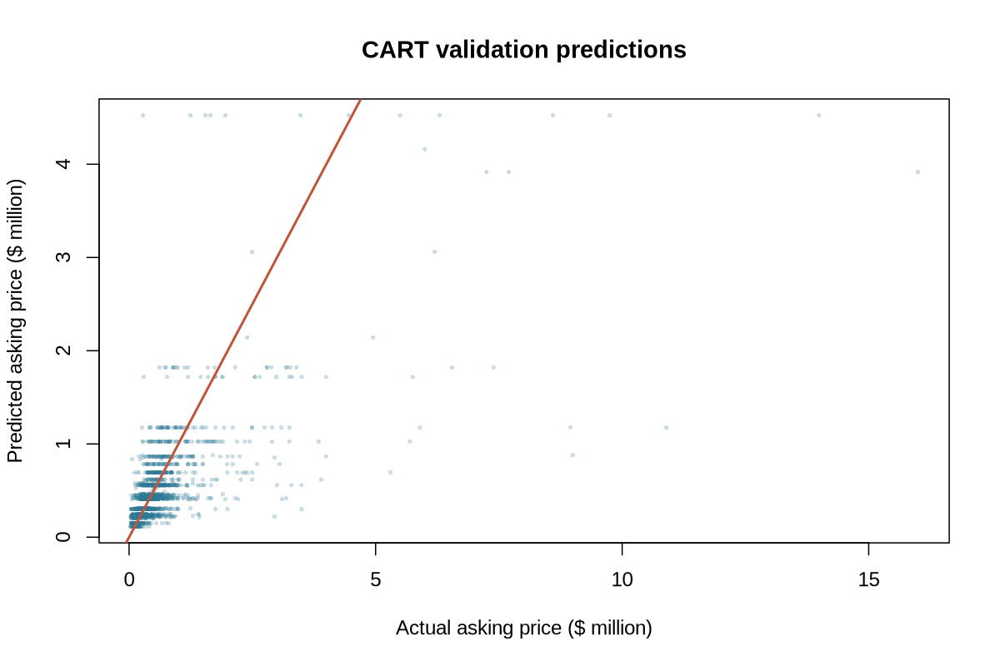

**Figure 4 — Single-tree error by real listing-price band.** This segmentation is for post-hoc evaluation only; the test here remains validation, not held-out test.

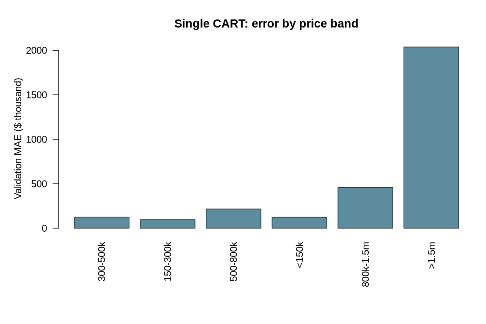

**Figure 5 — CART split-improvement importance.** Shows which fields help reduce *in-sample tree impurity*, NOT causes of home value.

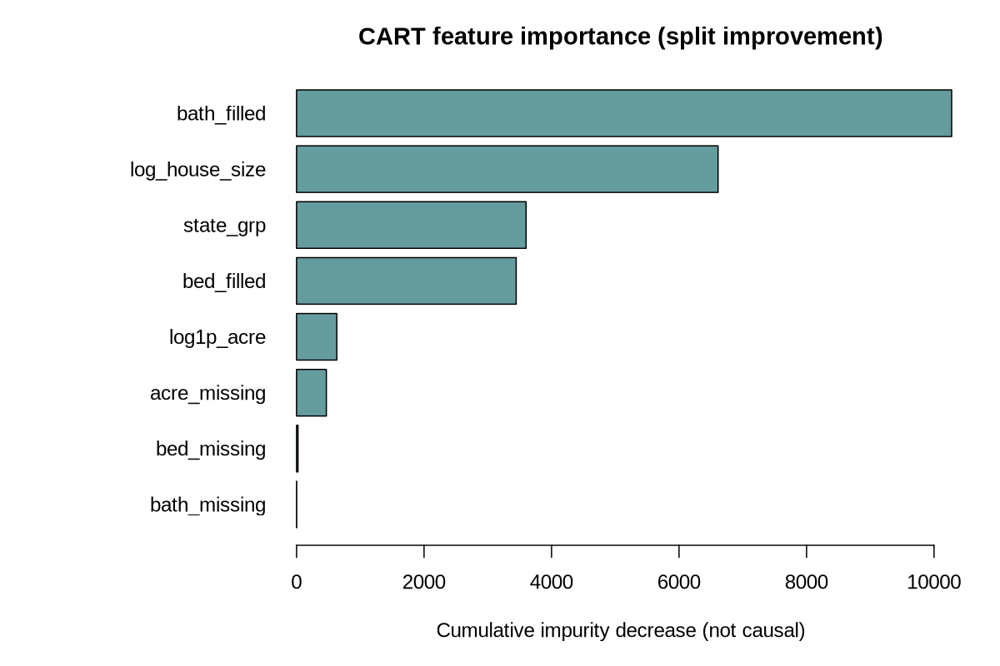

### Randomized bagging

**Figure 6 — Bagged ensemble predicted vs actual.** Uses 28 bootstrap trees and 5 of 8 predictors per tree (global random subspaces).

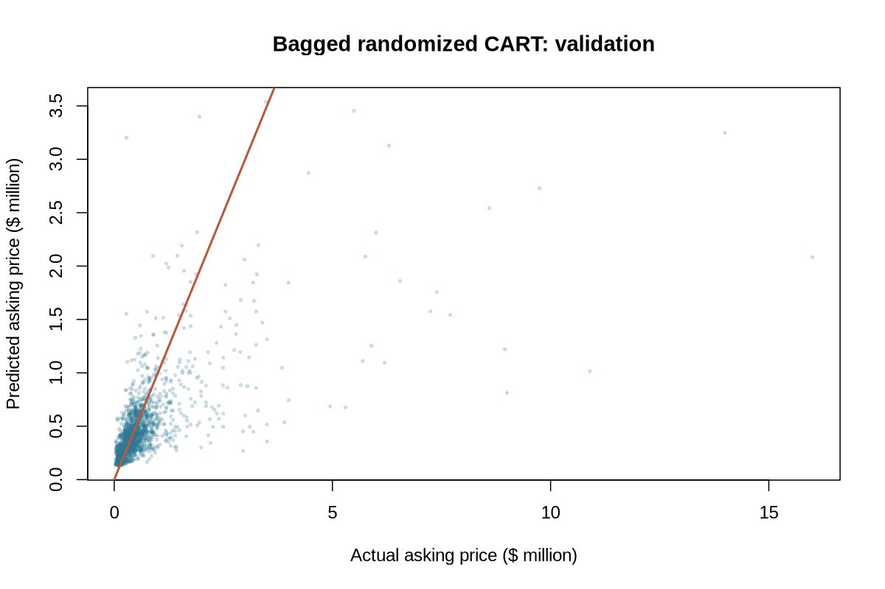

**Figure 7 — Bagging errors by price band.** Absolute dollar errors should be interpreted jointly with listing-price ranges.

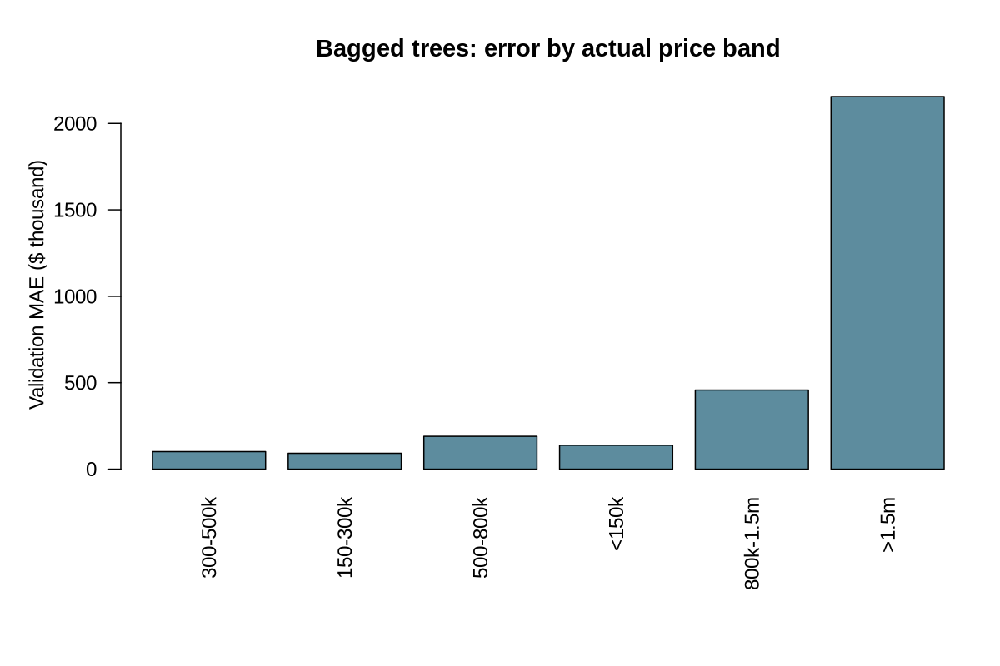

**Figure 8 — Ensemble split frequencies.** High split counts reflect the algorithm's predictive decisions and correlated features; no causal attribution can be read from these bars.

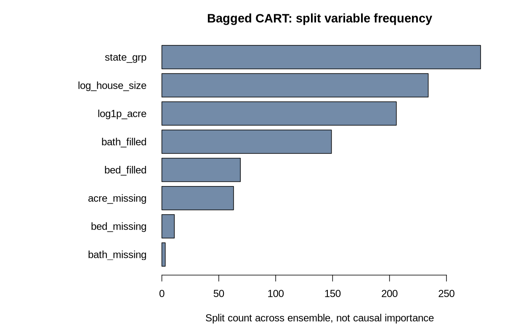

### Boosted ensemble and final ranking

**Figure 9 — Boosted CART asking-price predictions.** The strongest validation candidate, yet wide scatter highlights nontrivial residual uncertainty.

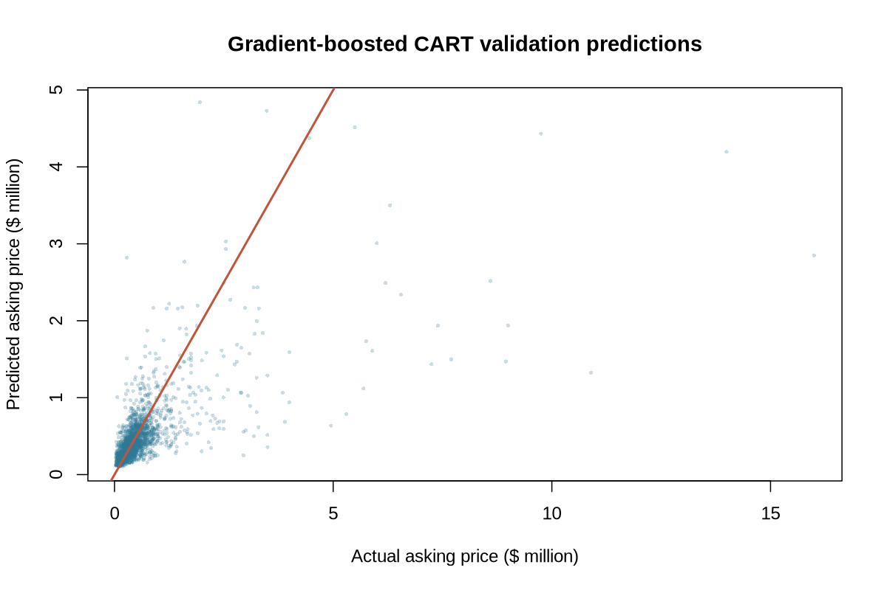

**Figure 10 — Boosted CART dollar errors by actual listing-price band.** Luxury tail remains challenging.

**Figure 11 — Four-family comparison.** Fixed validation data and declared dollar MAE.

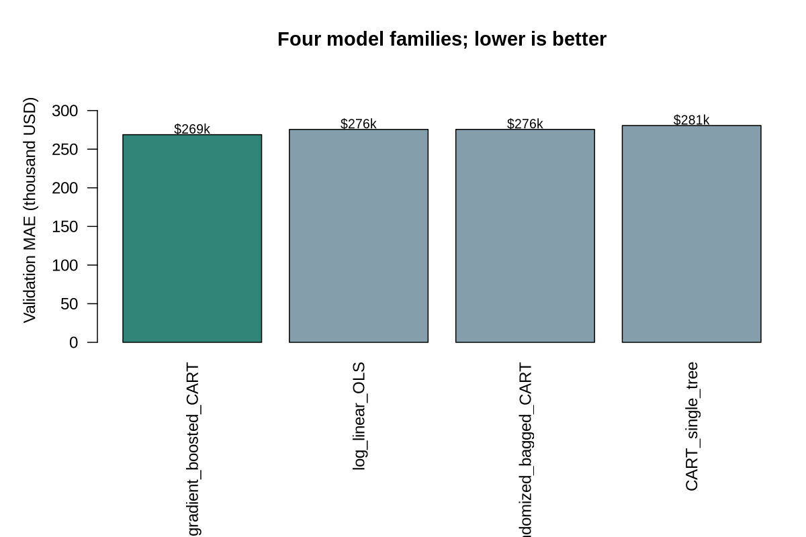

**Figure 12 — Validation metrics trade-off.** Compares MAE with log-RMSE so a lower-dollar-error model is not mistaken for universally best across all loss functions.

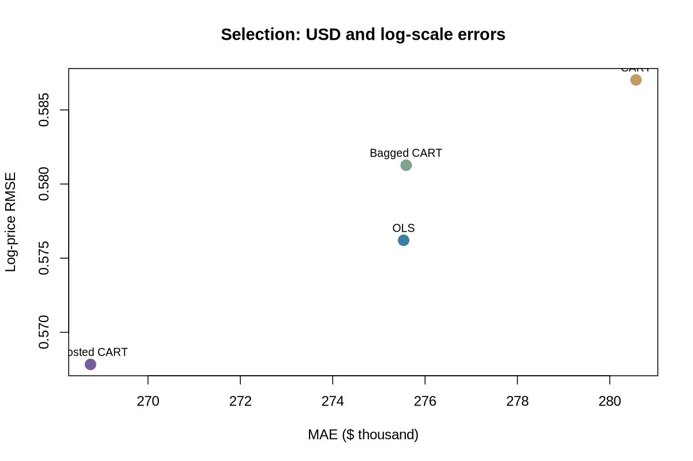

## 5. Business interpretation and predictive attribution

**Predictive drivers vs causal effects:** Living area, room counts, lot size and state may contribute to predictions, but tree split frequencies and OLS coefficients are **not experiments**, do not establish a room's renovation return, and cannot isolate macro-economic demand effects. The location variable is state rather than block/ZIP, limiting usable appraisal accuracy.

**Actionable workflow:** A brokerage analyst could use a predicted asking-price range as a *second opinion* for an otherwise comparable home, then investigate large deviations through manual comparables, property condition, recent local transactions, permit history and financing/carry costs. A difference between asking price and a model estimate is **not** evidence of an undervalued deal.

**What this model cannot answer:** achieved sale price, days-on-market, net yield, cap rate, cash flow, appreciation, fair-market appraisal, investment profitability, or 2026 market trends. The sample is not a verified longitudinal panel.

**Selection-stage next step:** Tune the winning boosted model *only on development data*, then freeze its parameters and evaluate the final untouched test set once. See the [fine-tuning report](../model_fine_tuning/report.md) for actual holdout errors and risk controls.

## 6. Reproduce the model-selection workflow

From repository root:

~~~sh
Rscript setup.R
Rscript EDA/eda.R
Rscript modeling/model_selection.R
~~~

Artifacts: `modeling/artifacts/selection_metrics.csv`, `selection_ranking.csv`, `selection_winner.csv`, and per-family local diagnostics. **These CSVs are local-only, Git-ignored**, as are source data, derived records and fitted binary models. The tracked report figures were generated by R and may be regenerated. `modeling/common.R` holds shared metrics and tree-ensemble routines.

**Dataset attribution:** Ahmed Shahriar Sakib, [USA Real Estate Dataset](https://www.kaggle.com/datasets/ahmedshahriarsakib/usa-real-estate-dataset), original Kaggle version 25. Data remain outside GitHub under the publisher's terms. No Kaggle leaderboard score exists for this dataset-only project.
